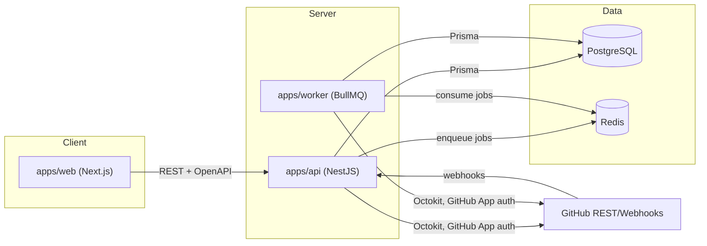
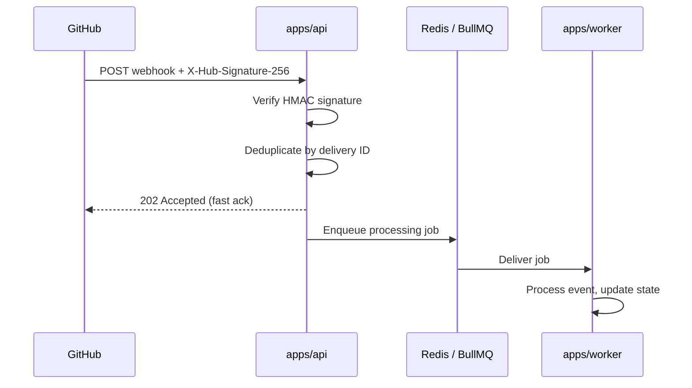
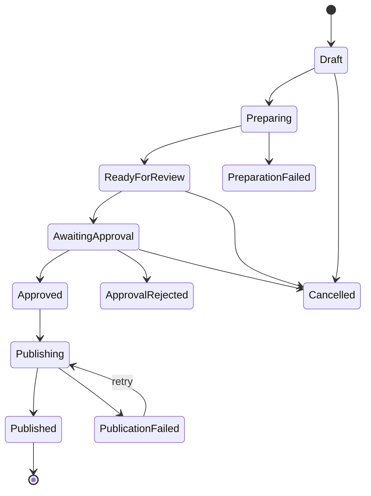
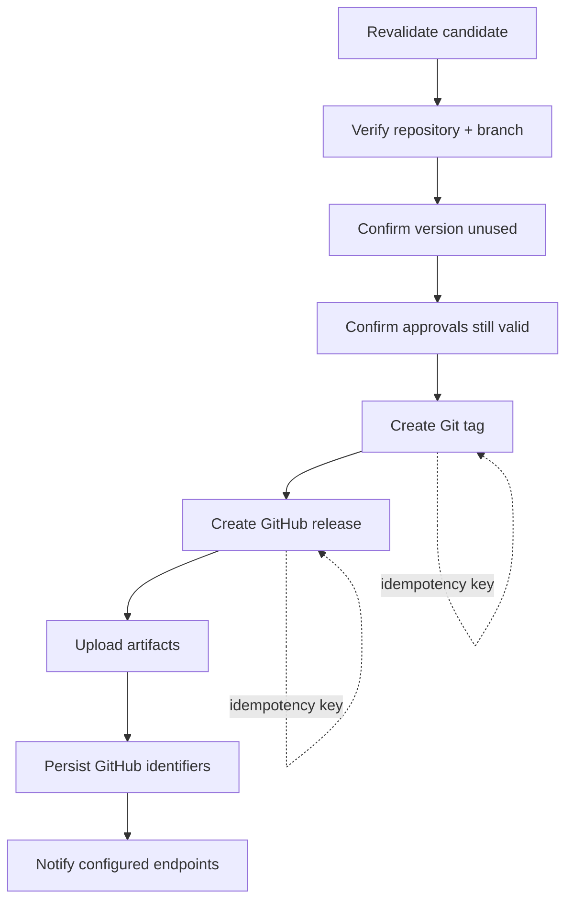
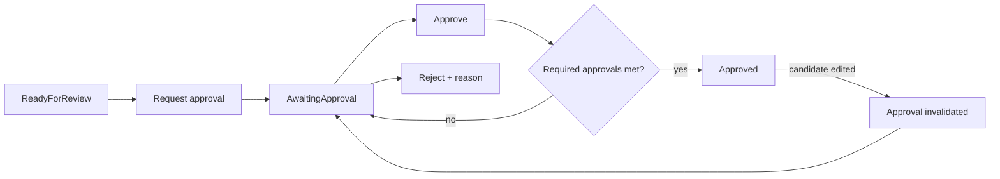
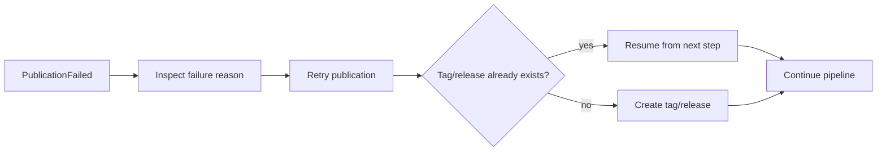

# Architecture

## Status

This document describes the target architecture. As of Phase 1 (Monorepo
Foundation), only the workspace structure, app/package boundaries, and
build pipeline exist — the diagrams below describe what each phase will
build, not what is running today. Each diagram is filled in with concrete
detail as its phase lands; treat unchecked phases as design intent.

## System overview



## GitHub App authentication (Phase 4)

```mermaid
sequenceDiagram
    participant API as apps/api
    participant GH as GitHub
    API->>GH: JWT signed with App private key
    GH-->>API: Installation access token (short-lived)
    API->>GH: Authenticated request (Octokit)
    Note over API: Token is never persisted;<br/>regenerated on expiry.
```

## Webhook processing (Phase 4 / Phase 10)



## Release lifecycle (Phase 6)



## Publication pipeline (Phase 10)



## Approval workflow (Phase 9)



## Retry / recovery (Phase 10)



## Monorepo boundaries

See [README.md](./README.md#monorepo-layout) for the package layout.
`apps/api` and `apps/worker` both depend on `packages/release-engine` so
release rules are defined exactly once and executed identically whether
triggered synchronously (API request) or asynchronously (background job).

## Architecture Decision Records

Significant, hard-to-reverse decisions are recorded in
[docs/adr/](./docs/adr/) rather than here, so the rationale survives even as
this document is edited.
